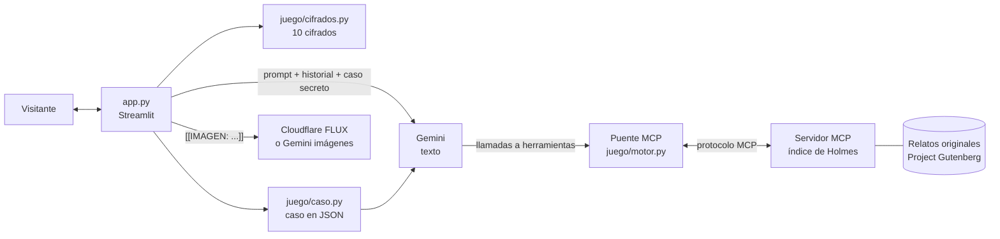

# 🔍 221B Baker Street — Un chatbot de Sherlock Holmes

> *«Usted ve, pero no observa.»*

Un asistente conversacional con la personalidad del Sherlock Holmes de los libros de Arthur Conan Doyle. Holmes deduce cosas sobre ti a partir de cómo escribes, resuelve los misterios que le traigas y te invita a investigar con él casos inventados en el momento, con escenas ilustradas y **mensajes cifrados que tú debes descifrar**. También puedes desafiarlo tú a él con un mensaje en clave, y al final Watson escribe tu aventura como un relato de la *Strand Magazine*.

**🎮 Pruébalo aquí:** [sherlockholmeschatbot.streamlit.app](https://sherlockholmeschatbot.streamlit.app)

<!-- Agrega aquí una captura o un GIF de una partida:  -->

---

## ¿Qué puedes hacer?

Al entrar al 221B, Holmes te recibe, hace una deducción sobre ti (la hora a la que escribes, tu ortografía, lo que mencionas…) y te ofrece dos caminos:

### A · «Traigo un caso»
Le cuentas un misterio, real o inventado, serio o cotidiano («¿quién se comió mi yogur?»). Holmes te interroga como a sus clientes, descarta lo imposible y te entrega su conclusión con toda la cadena de razonamiento.

### B · «Ayudar a Holmes»
Holmes tiene un caso abierto y tú eres su asistente:

1. **Eliges un expediente** entre tres carpetas: dos casos originales que se inventan en el momento y uno escrito a mano para tu dificultad, que funciona aunque Gemini esté saturado. El caso queda guardado en secreto en la aplicación (víctima, sospechosos, culpable, móvil y pistas) y la solución no cambia aunque hagas mil preguntas.
2. **Vas a la escena del crimen**, ilustrada con imágenes generadas al estilo de los grabados de la *Strand Magazine*.
3. **Interrogas sospechosos y examinas pistas**. Holmes te pone a prueba: «¿Qué concluye usted de esa mancha?».
4. **Aparecen mensajes cifrados**: debes descubrir **qué código es** y **qué dice**. Puedes pedir hasta tres pistas o rendirte.
5. **Haces la acusación final** (culpable y móvil) y Holmes revela la solución.
6. **El tablero de Holmes**: aparece un tablero de corcho con un hilo rojo que une cada pista con la persona que señala (o que descarta), y marca las pistas que se te pasaron por alto.

### Los casos escritos a mano

| Dificultad | Caso |
|---|---|
| Fácil | *El caso de la partitura robada* (Covent Garden) |
| Medio | *La aventura del candelabro torcido* (Belgravia) |
| Difícil | *La aventura del telegrafista de Whitehall*, con una pista falsa dejada a propósito |

### El relato de Watson
Al terminar un caso (o después de contarle el tuyo), Watson lo escribe como un cuento de la *Strand Magazine* donde el protagonista eres tú: lo que preguntaste, lo que descifraste y si acertaste. Usa solo lo que pasó en la conversación y se puede descargar.

### Desafiar a Holmes
Escríbele un mensaje en clave en el chat («Descifre esto: …») o desde la libreta, donde la aplicación puede cifrarlo por ti con el código que elijas. Holmes no sabe cuál elegiste: el código prueba todos los métodos, se queda con el resultado que más parece español y Holmes cuenta cómo lo descubrió (la letra que más se repite, el zigzag de la cerca…). Entiende tanto el alfabeto español como el inglés de 26 letras. Si no lo logra, no inventa: lo reconoce y, si parece un Vigenère, te pide la clave. Tampoco te resuelve los mensajes del caso que estás jugando.

### Los 10 códigos

| Dificultad | Códigos |
|---|---|
| Fácil | Código Morse · Escritura en espejo · Atbash |
| Medio | César · Bacon · Cuadrado de Polibio · Cerca (rail fence) |
| Difícil | Vigenère · Mensaje oculto cada tercera palabra (*El Gloria Scott*) · Los bailarines (*La aventura de los bailarines*) |

Los bailarines se dibujan con figuras propias: 27 posiciones (brazo izquierdo × brazo derecho × piernas) y una bandera que marca el fin de cada palabra, igual que en el relato.

---

## Fidelidad al personaje

- Personalidad, método y forma de hablar basados en los relatos originales (ver [`personaje/prompt_sistema.md`](personaje/prompt_sistema.md)).
- Vive en 1895: si le hablas de un celular, lo analiza como un artefacto desconocido.
- **Nunca dice «Elemental, mi querido Watson»**, porque esa frase no aparece en los libros, y se molesta si se la atribuyes.
- Tiene las costumbres de los relatos: toca el violín si se lo pides, se pone serio con Moriarty, presume de ignorar si la Tierra gira alrededor del Sol y corrige a quien lo llama «detective privado».
- Sus deducciones sobre ti usan solo datos reales de la conversación; nunca inventa que «ve barro en tus zapatos».
- Consulta su **índice** (un servidor MCP con los textos originales) cuando le preguntas por casos antiguos.

---

## Arquitectura



**Principio de diseño:** la IA pone la voz y la historia; **el código controla las reglas**.

- **Los cifrados los hace el código**, no la IA (los modelos se equivocan escribiendo Morse). Así cada mensaje es siempre correcto y descifrable. Están cubiertos por pruebas automáticas.
- **Descifrar también lo hace el código** ([`juego/descifrador.py`](juego/descifrador.py)): prueba los diez métodos y puntúa cada resultado según cuántas palabras españolas conocidas contiene y qué tan naturales son sus parejas de letras ([`juego/bigramas.py`](juego/bigramas.py), calculadas con los propios textos del proyecto). Gemini solo pone la voz.
- **El hilo rojo** se dibuja con código (SVG) a partir del caso guardado: no gasta consultas ni imágenes.
- **El caso se genera una sola vez en JSON** con esquema estricto y se le recuerda a Holmes en cada turno, por lo que la solución nunca cambia.
- **La aplicación y Holmes se comunican con etiquetas**: la app le envía `[CASO SECRETO]`, `[PISTA CIFRADA]`, `[RESULTADO]`…, y Holmes le pide cosas con `[[IMAGEN: …]]` o `[[MODO: B]]`, que la app quita antes de mostrar el mensaje.
- **El índice MCP** ([`indice_mcp/servidor.py`](indice_mcp/servidor.py)) expone dos herramientas (`buscar_en_mis_archivos`, `listar_relatos`) con búsqueda BM25 sobre los relatos. Un puente propio declara esas herramientas a Gemini y ejecuta las llamadas por el protocolo MCP. El servidor también funciona solo (`python indice_mcp/servidor.py`) con cualquier cliente MCP.
- **Imágenes gratis**: el nivel gratuito de Gemini no incluye imágenes, así que la app puede usar **Cloudflare Workers AI** (FLUX.1 [schnell], cuota diaria gratuita). Si no hay cuota de imágenes, Holmes describe las escenas con palabras y el juego sigue.
- **Resistencia a fallos**: si Gemini está saturado (503), se reintenta y luego responde un modelo de respaldo.
- **Protecciones de gasto**: máximo 3 imágenes por caso y un límite de mensajes por sesión.

### Estructura

```
Chatbots/
├── app.py                    # interfaz de chat (Streamlit)
├── personaje/
│   └── prompt_sistema.md     # la personalidad de Holmes
├── juego/
│   ├── motor.py              # conexión con Gemini + puente MCP
│   ├── imagenes_cloudflare.py # imágenes gratis con Cloudflare Workers AI
│   ├── caso.py               # caso secreto (JSON) y juicio del móvil
│   ├── caso_muestra.py       # los tres casos escritos a mano
│   ├── cifrados.py           # los 10 cifrados
│   ├── descifrador.py        # Holmes descifra los mensajes del visitante
│   ├── bigramas.py           # parejas de letras del español (para el descifrador)
│   ├── relato.py             # el relato de Watson
│   ├── fichas.py             # fichas, carpetas, tablero del hilo rojo y página de la Strand
│   └── partida.py            # reglas: etiquetas, pistas, puntaje
├── indice_mcp/
│   ├── servidor.py           # servidor MCP: el índice de Holmes
│   └── textos/               # relatos descargados de Gutenberg
├── scripts/
│   ├── descargar_libros.py
│   └── calcular_bigramas.py  # vuelve a calcular juego/bigramas.py
├── tests/                    # pruebas automáticas (pytest)
├── estilo/tema.css           # diseño: tablero de corcho, libreta de cuero y papeles clavados
├── static/                   # foto de la calle de Londres y medallón de Holmes
├── .streamlit/config.toml    # colores del tema y archivos estáticos
├── requirements.txt
├── LICENSE                   # licencia MIT
└── .env.example
```

---

## Cómo ejecutarlo en tu computador

Necesitas Python 3.10 o superior y una clave gratuita de [Google AI Studio](https://aistudio.google.com/apikey).

```bash
git clone https://github.com/santiaagoe/Chatbots.git
cd Chatbots

python -m venv .venv
# Windows: .venv\Scripts\activate    ·    macOS/Linux: source .venv/bin/activate
pip install -r requirements.txt

cp .env.example .env          # en Windows: copy .env.example .env
# edita .env y pon tu GEMINI_API_KEY
# (opcional) CLOUDFLARE_ACCOUNT_ID y CLOUDFLARE_API_TOKEN para imágenes gratis

python scripts/descargar_libros.py   # opcional: llena el índice de Holmes
streamlit run app.py
```

### Pruebas

```bash
pytest
```

Las pruebas verifican que cada cifrado se pueda descifrar (y que Holmes lo descubra solo, sin inventar nada ante un texto sin sentido), la coherencia de los casos escritos a mano, el tablero del hilo rojo, el relato de Watson, el servidor MCP, el puente con Gemini y partidas completas de punta a punta (con un Gemini simulado, sin gastar la API).

---

## Tecnologías

- **Python** + **Streamlit** (interfaz)
- **Google Gemini** (`google-genai`): conversación, salida JSON estructurada e imágenes
- **Cloudflare Workers AI** (FLUX.1 [schnell]): imágenes en el nivel gratuito
- **Model Context Protocol** con **FastMCP** (índice de los libros)
- **pytest**

## Créditos

- Personajes y relatos de **Sir Arthur Conan Doyle** (dominio público).
- Textos originales de [Project Gutenberg](https://www.gutenberg.org/).
- Proyecto creado para el concurso de ChatBots IA del CaDCC.

## Licencia

Código bajo licencia [MIT](LICENSE) © 2026 Santiago Espinoza Correa. Los relatos de Conan Doyle incluidos en `indice_mcp/textos/` son de dominio público.
