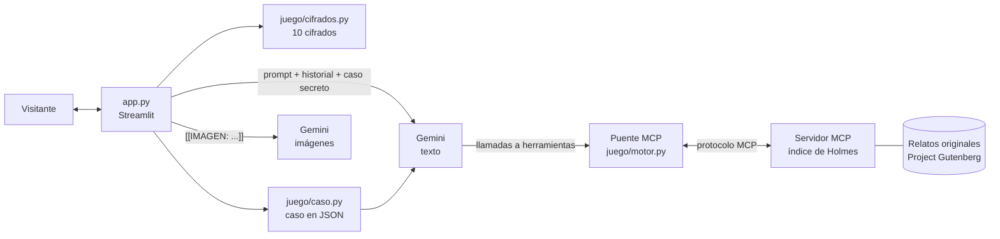

# 🔍 221B Baker Street — Un chatbot de Sherlock Holmes

> *«Usted ve, pero no observa.»*

Un asistente conversacional con la personalidad del Sherlock Holmes de los libros de Arthur Conan Doyle. Holmes deduce cosas sobre ti a partir de cómo escribes, resuelve los misterios que le traigas y te invita a investigar con él casos inventados en el momento, con escenas ilustradas y **mensajes cifrados que tú debes descifrar**.

**🎮 Pruébalo aquí:** `ENLACE_A_LA_DEMO` <!-- reemplazar tras publicar en Streamlit Cloud -->

<!-- Agrega aquí una captura o un GIF de una partida:  -->

---

## ¿Qué puedes hacer?

Al entrar al 221B, Holmes te recibe, hace una deducción sobre ti (la hora a la que escribes, tu ortografía, lo que mencionas…) y te ofrece dos caminos:

### A · «Traigo un caso»
Le cuentas un misterio, real o inventado, serio o cotidiano («¿quién se comió mi yogur?»). Holmes te interroga como a sus clientes, descarta lo imposible y te entrega su conclusión con toda la cadena de razonamiento.

### B · «Ayudar a Holmes»
Holmes tiene un caso abierto y tú eres su asistente:

1. **Se genera un caso original y secreto**: víctima, sospechosos, culpable, móvil y pistas. La solución queda guardada en la aplicación y no cambia aunque hagas mil preguntas.
2. **Vas a la escena del crimen**, ilustrada con imágenes generadas al estilo de los grabados de la *Strand Magazine*.
3. **Interrogas sospechosos y examinas pistas**. Holmes te pone a prueba: «¿Qué concluye usted de esa mancha?».
4. **Aparecen mensajes cifrados**: debes descubrir **qué código es** y **qué dice**. Puedes pedir hasta tres pistas o rendirte.
5. **Haces la acusación final** (culpable y móvil) y Holmes revela la solución.

### Los 10 códigos

| Dificultad | Códigos |
|---|---|
| Fácil | Código Morse · Escritura en espejo · Atbash |
| Medio | César · Bacon · Cuadrado de Polibio · Cerca (rail fence) |
| Difícil | Vigenère · Mensaje oculto cada tercera palabra (*El Gloria Scott*) · Los bailarines (*La aventura de los bailarines*) |

Los bailarines se dibujan con figuras propias: 27 posiciones (brazo izquierdo × brazo derecho × piernas) y una bandera que marca el fin de cada palabra, igual que en el relato.

---

## Fidelidad al personaje

- Personalidad, método y forma de hablar basados en los relatos originales (ver [`personaje/prompt_sistema.md`](personaje/prompt_sistema.md)).
- Vive en 1895: si le hablas de un celular, lo analiza como un artefacto desconocido.
- **Nunca dice «Elemental, mi querido Watson»**, porque esa frase no aparece en los libros.
- Sus deducciones sobre ti usan solo datos reales de la conversación; nunca inventa que «ve barro en tus zapatos».
- Consulta su **índice** (un servidor MCP con los textos originales) cuando le preguntas por casos antiguos.

---

## Arquitectura



**Principio de diseño:** la IA pone la voz y la historia; **el código controla las reglas**.

- **Los cifrados los hace el código**, no la IA (los modelos se equivocan escribiendo Morse). Así cada mensaje es siempre correcto y descifrable. Están cubiertos por pruebas automáticas.
- **El caso se genera una sola vez en JSON** con esquema estricto y se le recuerda a Holmes en cada turno, por lo que la solución nunca cambia.
- **La aplicación y Holmes se comunican con etiquetas**: la app le envía `[CASO SECRETO]`, `[PISTA CIFRADA]`, `[RESULTADO]`…, y Holmes le pide cosas con `[[IMAGEN: …]]` o `[[MODO: B]]`, que la app quita antes de mostrar el mensaje.
- **El índice MCP** ([`indice_mcp/servidor.py`](indice_mcp/servidor.py)) expone dos herramientas (`buscar_en_mis_archivos`, `listar_relatos`) con búsqueda BM25 sobre los relatos. Un puente propio declara esas herramientas a Gemini y ejecuta las llamadas por el protocolo MCP. El servidor también funciona solo (`python indice_mcp/servidor.py`) con cualquier cliente MCP.
- **Protecciones de gasto**: máximo 3 imágenes por caso y un límite de mensajes por sesión.

### Estructura

```
sherlock-chatbot/
├── app.py                    # interfaz de chat (Streamlit)
├── personaje/
│   └── prompt_sistema.md     # la personalidad de Holmes
├── juego/
│   ├── motor.py              # conexión con Gemini + puente MCP
│   ├── caso.py               # caso secreto (JSON) y juicio del móvil
│   ├── cifrados.py           # los 10 cifrados
│   └── partida.py            # reglas: etiquetas, pistas, puntaje
├── indice_mcp/
│   ├── servidor.py           # servidor MCP: el índice de Holmes
│   └── textos/               # relatos descargados de Gutenberg
├── scripts/
│   └── descargar_libros.py
├── tests/                    # pruebas automáticas (pytest)
├── .streamlit/config.toml    # tema victoriano
├── requirements.txt
└── .env.example
```

---

## Cómo ejecutarlo en tu computador

Necesitas Python 3.10 o superior y una clave gratuita de [Google AI Studio](https://aistudio.google.com/apikey).

```bash
git clone https://github.com/TU_USUARIO/sherlock-chatbot.git
cd sherlock-chatbot

python -m venv .venv
# Windows: .venv\Scripts\activate    ·    macOS/Linux: source .venv/bin/activate
pip install -r requirements.txt

cp .env.example .env          # en Windows: copy .env.example .env
# edita .env y pon tu GEMINI_API_KEY

python scripts/descargar_libros.py   # opcional: llena el índice de Holmes
streamlit run app.py
```

### Pruebas

```bash
pytest
```

Las pruebas verifican que cada cifrado se pueda descifrar, el servidor MCP, el puente con Gemini y una partida completa de punta a punta (con un Gemini simulado, sin gastar la API).

---

## Tecnologías

- **Python** + **Streamlit** (interfaz)
- **Google Gemini** (`google-genai`): conversación, salida JSON estructurada e imágenes
- **Model Context Protocol** con **FastMCP** (índice de los libros)
- **pytest**

## Créditos

- Personajes y relatos de **Sir Arthur Conan Doyle** (dominio público).
- Textos originales de [Project Gutenberg](https://www.gutenberg.org/).
- Proyecto creado para el concurso de ChatBots IA del CaDCC.
